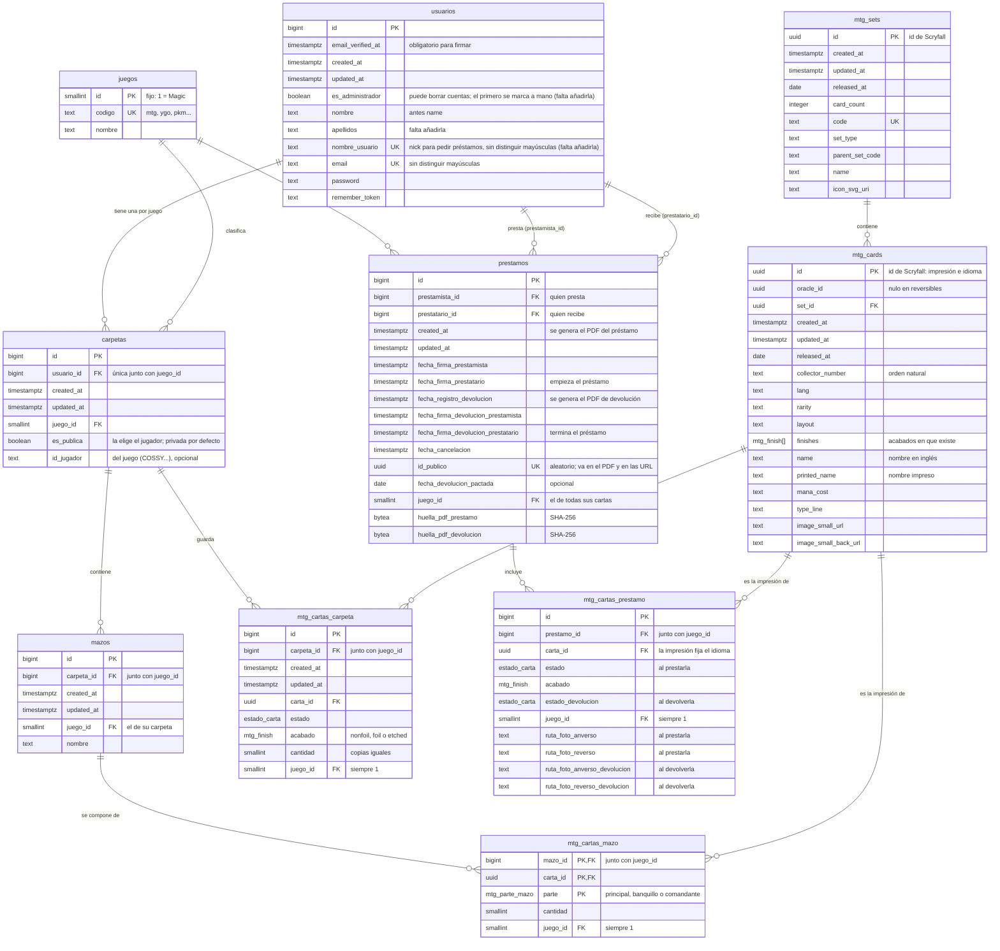

# Modelo de datos

Tablas del catálogo de cartas y de los jugadores. Hay de tres tipos:

- **Las crea el ETL** a partir de [`python-scripts/esquema.sql`](../../python-scripts/esquema.sql): `mtg_sets` y `mtg_cards`.
- **La crea Laravel**: `usuarios`, en la migración `0001_01_01_000000_create_users_table.php`,
  que hoy la crea con el nombre `users`. Como la base de datos todavía no existe, esa migración
  se cambia directamente, sin añadir otra: la tabla pasa a llamarse `usuarios`, `name` pasa a
  `nombre`, se añaden `apellidos`, `nombre_usuario` y `es_administrador`, las fechas son
  `timestamptz` y `email` usa la colación `ignora_mayusculas` (ver
  [Decisiones de diseño](#decisiones-de-diseño)). Si ya tienes una base de datos local de una
  puesta en marcha anterior, `php artisan migrate` no aplica el cambio, porque da la migración
  por ejecutada. Hay que recrearla con `php artisan migrate:fresh` y volver a
  [lanzar el ETL](../procesos/ejecucion-proyecto.md#lanzar-el-etl), porque `migrate:fresh`
  también borra el catálogo.
- **Propuestas, todavía sin migración**: el resto.

Cada juego tiene su propio catálogo, con los ids de su fuente (en Magic, el uuid de Scryfall).
Las tablas de un juego llevan su código como prefijo (`mtg_`), y las comunes a todos los
juegos no llevan prefijo.

Los nombres están en español, salvo los del catálogo y los que da por hechos Laravel (ver
[Los nombres están en español](#los-nombres-están-en-español)).

## Diagrama



## Tablas

| Tabla | Ámbito | Qué guarda |
| --- | --- | --- |
| `usuarios` | Común | Jugadores y administradores. Un préstamo se pide buscando el nombre de usuario de la otra parte, y los PDF muestran el nombre y los apellidos |
| `juegos` | Común | Juegos de cartas, con un id fijo para cada uno |
| `carpetas` | Común | La colección de un jugador en un juego, su ID de jugador en ese juego y si los demás pueden verla. Una por jugador y juego |
| `mazos` | Común | Mazos de una carpeta |
| `prestamos` | Común | Un préstamo de cartas de un juego entre dos jugadores: quién presta, quién recibe, las firmas de los dos PDF y las fechas |
| `mtg_sets` | Magic | Expansiones cargadas desde Scryfall |
| `mtg_cards` | Magic | Impresiones en cada idioma, cargadas desde Scryfall, con los acabados en que existen |
| `mtg_cartas_carpeta` | Magic | Cartas de una carpeta: qué impresión, con qué acabado, en qué estado y cuántas copias |
| `mtg_cartas_mazo` | Magic | Qué impresiones forman cada mazo, en qué parte del mazo y cuántas copias |
| `mtg_cartas_prestamo` | Magic | Cada copia prestada, con su acabado, y su estado y fotos de las dos caras al prestarla y al devolverla |

Para añadir un juego hay que darlo de alta en `juegos` y crear sus cinco tablas: `<juego>_sets`,
`<juego>_cards`, `<juego>_cartas_carpeta`, `<juego>_cartas_mazo` y `<juego>_cartas_prestamo`.
El catálogo (`<juego>_sets` y `<juego>_cards`) usa los nombres de su fuente.

## Formas normales

Las tablas de los jugadores están en tercera forma normal (3FN), salvo `juego_id`, que se repite
a propósito. El catálogo de Magic (`mtg_cards`) no se normaliza, porque es una copia de
Scryfall.

- **1FN**: cada columna guarda un solo valor.
- **2FN**: ninguna columna depende solo de una parte de una clave.
- **3FN**: ninguna columna depende de otra columna que no sea clave.

| Tabla | Claves candidatas | Forma normal |
| --- | --- | --- |
| `usuarios` | `id`; `email` y `nombre_usuario` también son únicos | 3FN |
| `juegos` | `id`, `codigo` | 3FN |
| `carpetas` | `id`, `(usuario_id, juego_id)` | 3FN |
| `mazos` | `id` | 3FN salvo `juego_id` |
| `prestamos` | `id`, `id_publico` | 3FN |
| `mtg_cartas_carpeta` | `id`, `(carpeta_id, carta_id, acabado, estado)` | 3FN salvo `juego_id` |
| `mtg_cartas_mazo` | `(mazo_id, carta_id, parte)` | 3FN salvo `juego_id` |
| `mtg_cartas_prestamo` | `id` | 3FN salvo `juego_id` |
| `mtg_sets` | `id`, `code` | 3FN |
| `mtg_cards` | `id` | Sin normalizar: copia de Scryfall |

En `prestamos`, `juego_id` no se repite: es un dato del propio préstamo, que no se deduce de
ninguna otra columna.

Dos decisiones de diseño evitan columnas que romperían la 3FN:

- [El estado del préstamo sale de sus fechas](#el-estado-del-préstamo-sale-de-sus-fechas): una
  columna de estado dependería de las fechas de firma y de cancelación.
- [El idioma de la carta prestada lo fija la impresión](#el-idioma-de-la-carta-prestada-lo-fija-la-impresión):
  una columna de idioma en las copias dependería de `carta_id`.

### `juego_id` se repite a propósito

En `mazos`, `mtg_cartas_carpeta`, `mtg_cartas_mazo` y `mtg_cartas_prestamo`, `juego_id` se
puede deducir de la carpeta, del mazo o del préstamo:

- En `mazos` depende de `carpeta_id`, y en `mtg_cartas_prestamo` de `prestamo_id`. Ninguna de
  las dos es clave (`id → carpeta_id → juego_id`), así que rompe la 3FN.
- En `mtg_cartas_carpeta` y `mtg_cartas_mazo` depende solo de `carpeta_id` o de `mazo_id`, una
  parte de su clave. Rompe la 2FN.

Se guarda porque es la única forma de que PostgreSQL compruebe, sin triggers, que una carpeta,
un mazo o un préstamo solo tiene cartas de su juego (ver
[La base de datos garantiza que una carpeta solo tiene cartas de su juego](#la-base-de-datos-garantiza-que-una-carpeta-solo-tiene-cartas-de-su-juego)).

No causa las anomalías que evita la 3FN, porque nunca puede contradecir a la fila de la que
depende:

- La clave ajena compuesta obliga a que coincida con el `juego_id` de la carpeta, del mazo o
  del préstamo.
- En las tablas `mtg_` vale siempre 1 (`CHECK (juego_id = 1)`).
- `carpetas.juego_id`, `mazos.juego_id` y `prestamos.juego_id` no se pueden cambiar mientras
  una fila apunte a ellos, porque las claves ajenas compuestas lo impiden (`ON UPDATE NO
  ACTION`, la opción por defecto).

### El catálogo de Magic no se normaliza

`mtg_cards` guarda cada impresión tal como la da Scryfall:

- `finishes` es una lista de acabados. Rompe la 1FN.
- `name`, `mana_cost` y `type_line` son del texto Oracle de la carta, que es el mismo en todas
  sus impresiones e idiomas. Dependen de `oracle_id`, no de la impresión
  (`id → oracle_id → name`). Rompe la 3FN.

Se deja así porque es una copia de solo lectura de Scryfall. Solo la escribe el ETL, que
reescribe cada fila entera con los datos de Scryfall, y la aplicación no la modifica nunca. La
normalización evita que se cambie un dato en una fila y no en las demás que lo repiten, y aquí
nadie cambia los datos a mano. Las tablas de los jugadores no se ven afectadas: apuntan a
`mtg_cards.id`, que sí es la clave de la impresión.

Tiene dos consecuencias:

- **El texto Oracle puede ser distinto en cada expansión.** Una carga por expansión solo
  reescribe las impresiones de esa expansión. Si Scryfall corrige el texto Oracle de una carta,
  por ejemplo con un cambio de tipo de criatura, sus impresiones de otras expansiones conservan
  el anterior hasta que se vuelvan a cargar con `--set` o `--completa`.
- **El acabado de una copia lo comprueba la aplicación.** Como `finishes` es una lista, una
  clave ajena no puede comprobar que el acabado de una copia existe en su impresión (ver
  [Restricciones](#restricciones)).

## Decisiones de diseño

### Los nombres están en español

Las tablas, las columnas, los tipos enumerados y sus valores tienen nombres en español, sin
tildes, sin «ñ» y sin otros caracteres especiales. Hay tres excepciones:

- **El catálogo**: `mtg_sets`, `mtg_cards` y el tipo `mtg_finish` usan los nombres de
  Scryfall, porque son una copia suya. Los crea el ETL y la aplicación no los modifica.
- **Lo que da por hecho Laravel**: las columnas `id`, `created_at`, `updated_at`, `email`,
  `email_verified_at`, `password` y `remember_token`, y las tablas internas del framework
  (`sessions`, `password_reset_tokens`, `cache`, `jobs`…). El inicio de sesión, la verificación
  del correo, el cambio de contraseña y los avisos por correo las usan con esos nombres, y
  traducirlas obligaría a redefinir partes del framework.
- **Los códigos de Cardmarket** de `estado_carta` (`NM`, `EX`…), que son los de su guía.

Hay tres reglas para las columnas:

- Las claves ajenas se llaman como su tabla en singular más `_id` (`carpeta_id`,
  `prestamo_id`). Las excepciones son `prestamista_id` y `prestatario_id`, que dicen el papel
  de cada usuario, y `carta_id`, que apunta al catálogo (`mtg_cards`, y en otros juegos
  `<juego>_cards`): la tabla conserva su nombre en inglés, pero la columna va en español.
- Las fechas empiezan por `fecha_`, salvo las de Laravel.
- Los identificadores que no son claves ajenas llevan `id` delante: `id_jugador` e
  `id_publico`.

Laravel deduce el nombre de la tabla poniendo el del modelo en plural en inglés:
`MtgCartaPrestamo` daría `mtg_carta_prestamos`. Por eso cada modelo define `$table`, y el
modelo `User` usa `usuarios`.

### Las tablas que apuntan a una carta son de cada juego

Las cartas de cada juego están en su propia tabla y con su propio tipo de id. Por eso las
tablas que apuntan a una carta (carpeta, mazo y préstamo) también son de cada juego. Cada
referencia es una clave ajena real y del tipo correcto (`uuid` en Magic). Con una referencia
polimórfica (`tipo_carta` + `carta_id`), la base de datos no podría comprobar que la carta
existe.

Además, cada juego puede tener columnas propias sin dejar columnas vacías en los demás. Por
ejemplo, el acabado foil o etched (`acabado`) y el comandante del mazo (`parte`) son de Magic.

Lo que es igual en todos los juegos se queda en una sola tabla: jugadores, carpetas, mazos y
la cabecera del préstamo.

### La base de datos garantiza que una carpeta solo tiene cartas de su juego

`mtg_cartas_carpeta` no puede apuntar a una carpeta de Pokémon. Para que lo compruebe la propia
base de datos, se usa una clave ajena compuesta:

- `carpetas` tiene una restricción `UNIQUE (id, juego_id)`.
- `mtg_cartas_carpeta.juego_id` vale siempre 1 (`DEFAULT 1 CHECK (juego_id = 1)`).
- La clave ajena `(carpeta_id, juego_id)` apunta a `carpetas (id, juego_id)`, así que solo
  encaja con carpetas de Magic.

`mazos` y `mtg_cartas_mazo` usan el mismo mecanismo, y también `mtg_cartas_prestamo` con
`prestamos` (ver [Un préstamo es de un solo juego](#un-préstamo-es-de-un-solo-juego)). Así, un
mazo solo puede tener cartas del juego de su carpeta, y un préstamo, cartas de su juego. En
`mtg_cartas_carpeta` y `mtg_cartas_mazo`, la columna extra ocupa 2 bytes que caben en el
relleno que ya había al final de la fila, así que no ocupa espacio.

### Una copia de Magic se distingue también por su acabado

En Scryfall, una impresión en un idioma tiene un solo `id` aunque exista en normal, foil y
etched (el campo `finishes`). Una copia foil y una normal de la misma impresión valen
distinto, así que el acabado es parte de la copia:

- En `mtg_cartas_carpeta`, `acabado` forma parte de la clave única: las copias se agrupan por
  impresión, acabado y estado.
- En `mtg_cartas_prestamo`, `acabado` deja constancia de qué copia exacta se prestó.

El ETL guarda en `mtg_cards.finishes` los acabados en que existe cada impresión, y la
aplicación solo acepta para una copia un acabado de esa lista. Por ejemplo, no deja registrar
como foil una carta que solo se imprimió en normal.

`mtg_cartas_mazo` no tiene acabado, porque el acabado no cambia cómo se juega la carta.

### Una carta puede estar a la vez en el mazo principal y en el banquillo

`mtg_cartas_mazo.parte` indica en qué parte del mazo va la carta: el mazo principal
(`principal`), el banquillo (`banquillo`) o el comandante (`comandante`). Forma parte de la
clave primaria, así que un mazo puede llevar dos copias de una carta en el principal y otras
dos en el banquillo. Con la clave `(mazo_id, carta_id)` eso no era posible.

### Los estados, los acabados y las partes del mazo son tipos enumerados

```sql
CREATE TYPE estado_carta   AS ENUM ('PO', 'PL', 'LP', 'GD', 'EX', 'NM', 'MT');
CREATE TYPE mtg_finish     AS ENUM ('nonfoil', 'foil', 'etched');
CREATE TYPE mtg_parte_mazo AS ENUM ('principal', 'banquillo', 'comandante');
```

`estado_carta` usa los códigos de la
[guía de condiciones de Cardmarket](https://help.cardmarket.com/en/CardCondition), de peor a
mejor: Poor, Played, Light Played, Good, Excellent, Near Mint y Mint. Cardmarket usa la misma
escala en todos los juegos, así que el tipo es común. Los tipos con prefijo `mtg_` son de
Magic. `mtg_finish` usa los mismos valores que Scryfall y lo crea el ETL en `esquema.sql`,
porque lo usa `mtg_cards.finishes`; las migraciones de Laravel lo reutilizan.

Un enumerado tiene dos ventajas sobre un texto: rechaza cualquier valor que no esté en la
lista y ocupa siempre 4 bytes. Además, sus valores se ordenan según la lista: como
`estado_carta` va de peor a mejor, `estado >= 'EX'` significa "Excellent o mejor".

En PostgreSQL, `$table->enum()` de Laravel crea un `varchar` con un `CHECK`, no un tipo
enumerado. `estado_carta` y `mtg_parte_mazo` se crean en la migración con
`DB::statement()`, dentro del mismo bloque `DO` que usa `esquema.sql` para `mtg_finish`:

```sql
DO $$
BEGIN
    CREATE TYPE estado_carta AS ENUM ('PO', 'PL', 'LP', 'GD', 'EX', 'NM', 'MT');
EXCEPTION WHEN duplicate_object THEN NULL;
END
$$;
```

La sentencia tiene que poder repetirse. `migrate:fresh`, y `RefreshDatabase` en los tests,
borran las tablas pero no los tipos (salvo con `--drop-types`) ni las colaciones. Sin el
bloque, la migración fallaría desde la segunda vez con `type "estado_carta" already exists`.

### El estado del préstamo sale de sus fechas

`prestamos` no tiene una columna de estado. El estado se deduce de las fechas:

| Estado | Fechas |
| --- | --- |
| Pendiente de firmar | `fecha_firma_prestatario` y `fecha_cancelacion` nulas, y no han pasado dos semanas desde `created_at` |
| Activo | `fecha_firma_prestatario` con fecha y `fecha_registro_devolucion` nula |
| Devolución pendiente de firmar | `fecha_registro_devolucion` con fecha y `fecha_firma_devolucion_prestatario` nula |
| Devuelto | `fecha_firma_devolucion_prestatario` con fecha |
| Cancelado | `fecha_cancelacion` con fecha |
| Caducado | `fecha_firma_prestatario` y `fecha_cancelacion` nulas, y han pasado dos semanas desde `created_at` |

Cada paso necesita el anterior, y lo comprueban las [restricciones](#restricciones):

1. Quien presta registra el préstamo (`created_at`) y se genera el PDF del préstamo.
2. Lo firma quien presta (`fecha_firma_prestamista`) y después quien recibe
   (`fecha_firma_prestatario`). Con la segunda firma empieza el préstamo.
3. Quien presta recibe las cartas y registra la devolución (`fecha_registro_devolucion`), con el
   estado y las fotos de cada copia. Se genera el PDF de devolución.
4. Lo firma quien presta (`fecha_firma_devolucion_prestamista`) y después quien recibe
   (`fecha_firma_devolucion_prestatario`). Esa es la «fecha de confirmación» de la devolución,
   y con ella termina el préstamo.

Hasta que firma quien recibe, quien presta puede corregir el préstamo o la devolución: se
genera otro PDF y tiene que volver a firmar (ver
[Los PDF los firman los dos jugadores por correo y los sella shared-binder](#los-pdf-los-firman-los-dos-jugadores-por-correo-y-los-sella-shared-binder)).
Si quien recibe no firma la devolución, el préstamo se queda en «Devolución pendiente de
firmar»: es un desacuerdo, y shared-binder solo deja constancia. Los desacuerdos, como este o
unas cartas que no vuelven, se aclaran fuera de la aplicación: los jugadores mandan sus pruebas
a un correo de soporte.

Solo lo cancela quien presta, y solo antes de que lo firme quien recibe: es retirarlo. Quien
recibe no lo rechaza: si no lo firma, el préstamo caduca a las dos semanas de crearlo, y las
restricciones impiden firmarlo después. Corregir el préstamo no alarga el plazo. Las dos
semanas se cuentan en horas (`created_at + interval '336 hours'`), en las restricciones y en
las consultas, para que el límite no dependa de la zona horaria ni de los cambios de hora. Un
pacto firmado por los dos solo termina con la devolución.

No hay columnas de «aceptado» ni de «devuelto», porque repetirían `fecha_firma_prestatario` y
`fecha_firma_devolucion_prestatario`.

Los avisos llegan por correo, con el enlace para firmar. La pantalla de pendientes de cada
jugador sale de estas fechas: los préstamos en los que participa, sin caducar ni cancelar, a
los que les falta su firma. No hace falta la tabla `notifications` de Laravel.

Así el estado nunca contradice a las fechas. Por ejemplo, no puede haber un préstamo
"devuelto" sin las firmas de la devolución. Además queda registrado cuándo ocurrió cada paso,
y eso es justo lo que necesita un testigo del pacto.

### Las fechas son `timestamptz`

Las tablas del ETL usan `timestamptz`. En cambio, `$table->timestamps()` de Laravel crea en
PostgreSQL columnas `timestamp without time zone`, como las que crea hoy la migración de
`users`. Las tablas de los jugadores usan `$table->timestampsTz()` y `$table->timestampTz()`,
y la migración de `usuarios` se cambia para usarlas también.

La conexión `pgsql` de `config/database.php` fija además `'timezone' => 'UTC'`. Laravel envía
las fechas sin zona horaria y PostgreSQL las interpreta en la zona de la sesión. Sin esa
opción, un servidor con otra zona por defecto guardaría las horas desplazadas, y no
coincidirían con las que escribe el ETL con `now()`.

Un `timestamptz` guarda un instante exacto. Un `timestamp` sin zona guarda solo la fecha y la
hora, sin decir de qué zona horaria; si cambia la zona de la aplicación o del servidor, las
fechas antiguas cambian de significado. Un testigo de cuándo se firmó un préstamo o su
devolución no puede tener fechas ambiguas. Los dos tipos ocupan 8 bytes.

### El correo, el usuario y el ID de jugador no distinguen mayúsculas

```sql
CREATE COLLATION IF NOT EXISTS ignora_mayusculas (provider = icu, locale = 'und-u-ks-level2', deterministic = false);
```

`usuarios.email`, `usuarios.nombre_usuario` y `carpetas.id_jugador` usan esta colación. Con
ella:

- La restricción única rechaza `Ana` si ya existe `ana`. Un préstamo se pide buscando a la otra
  parte por su nombre de usuario, y el ID de jugador aparece en los PDF del préstamo. Dos
  jugadores que solo se diferencian en las mayúsculas podrían hacerse pasar uno por otro.
- Las consultas de Laravel (`where('email', …)`, el inicio de sesión y la regla de validación
  `unique:usuarios`) comparan sin distinguir mayúsculas, sin `lower()` ni índices de
  expresión.

Las tildes sí se distinguen: `jose` y `josé` son usuarios distintos.

La migración de `usuarios` crea la colación antes que la tabla (con `IF NOT EXISTS`, porque
`migrate:fresh` no borra las colaciones), y crea `email` y `nombre_usuario` ya con ella
(`->collation('ignora_mayusculas')`). La migración de `carpetas` crea `id_jugador` también con
ella.

### El nombre de usuario sirve para encontrar a la otra parte

Un préstamo se pide buscando a la otra parte por su nombre de usuario (`nombre_usuario`), el
nick de la aplicación. Así nadie tiene que conocer ni ver el correo de otro jugador. Por eso es
obligatorio: a quien no lo tuviera no se le podría pedir un préstamo.

Los PDF no lo muestran: llevan el nombre y los apellidos de cada jugador y, si lo tiene, su ID
de jugador en el juego.

### El ID de jugador es de cada juego

Los PDF muestran, junto al nombre y los apellidos de cada jugador, su ID de jugador opcional,
por ejemplo el COSSY ID de Yu-Gi-Oh!. Cada juego tiene el suyo, así que va en
`carpetas.id_jugador`, que como la carpeta es único por jugador y juego. Quien quiera poner su
ID sin tener cartas de ese juego tiene una carpeta vacía.

Lo escribe el jugador y shared-binder no lo comprueba. No se repite dentro de un juego
(`UNIQUE (juego_id, id_jugador)`) ni distingue mayúsculas, para que nadie aparezca en un PDF
con el ID de otro. Por lo mismo, si alguien registra antes un ID que no es suyo, su dueño no
lo puede registrar.

Los demás jugadores solo lo ven si la carpeta es pública (ver
[El jugador decide si su carpeta es pública](#el-jugador-decide-si-su-carpeta-es-pública)),
pero siempre aparece en los PDF de los préstamos de ese juego. La restricción única sí deja
saber que un ID ya está registrado aunque su carpeta sea privada: el mensaje de error dice solo
que ese ID no se puede usar, sin decir de quién es.

### El jugador decide si su carpeta es pública

`carpetas.es_publica` dice si los demás jugadores pueden ver la carpeta. Si es privada, no ven
sus cartas, sus mazos ni su ID de jugador, y no aparece al buscar quién tiene una carta para
pedírsela prestada. Los préstamos no cambian: la otra parte ve las cartas prestadas y los dos
ID de jugador en los PDF.

Es privada por defecto (`NOT NULL DEFAULT false`). El RGPD pide que, por defecto, los datos
personales no sean accesibles a un número indeterminado de personas sin que el interesado
intervenga (artículo 25.2), y una carpeta es de una persona con nombre y apellidos.

### Un préstamo es de un solo juego

`prestamos.juego_id` dice de qué juego son sus cartas. `mtg_cartas_prestamo` usa el mismo
mecanismo que las carpetas: la clave ajena `(prestamo_id, juego_id)` apunta a
`prestamos (id, juego_id)`, y `juego_id` vale siempre 1. Así:

- El PDF muestra un solo ID de jugador por persona: el de ese juego.
- Para saber si un préstamo tiene al menos una carta, basta con mirar la tabla de su juego.

Para prestar cartas de dos juegos se hacen dos préstamos.

### Los PDF los firman los dos jugadores por correo y los sella shared-binder

Cada préstamo tiene dos documentos, como los ejemplos [del préstamo](../ejemplos/ejemplo-prestamo.pdf)
y [de la devolución](../ejemplos/ejemplo-devolucion.pdf). Cada uno se genera cuando quien presta
registra el préstamo o la devolución, y se guarda con un nombre fijo junto a las fotos:
`prestamos/{id_publico}/prestamo.pdf` y `prestamos/{id_publico}/devolucion.pdf`. Como la ruta es fija, no hace
falta guardarla en una columna.

Mientras quien recibe no lo ha firmado, quien presta puede corregir el préstamo o la
devolución. Entonces se genera otro PDF, que sustituye al anterior, y se borra la firma de
quien presta (`fecha_firma_prestamista` o `fecha_firma_devolucion_prestamista`), que tiene que
volver a firmar. El PDF anterior se descarta a propósito: solo lo había firmado una parte, así
que no era un pacto. Cuando firma quien recibe, el PDF ya no se vuelve a generar, y lo firmado
no cambia aunque después cambien los nombres de `usuarios`, el ID de jugador o el catálogo.

En ese momento, la aplicación envía el PDF firmado por correo a los dos jugadores, que así
tienen su propia copia. shared-binder conserva la suya en el disco (ver
[Cada copia prestada tiene foto del anverso y del reverso](#cada-copia-prestada-tiene-foto-del-anverso-y-del-reverso)).
Los adjuntos tienen un límite de tamaño, normalmente entre 10 y 25 MB según el servidor, así que
las fotos se comprimen al guardarlas.

`huella_pdf_prestamo` y `huella_pdf_devolucion` guardan el SHA-256 del PDF tal como se genera,
sin firmas (32 bytes). La de la devolución es nula hasta que se registra la devolución. Las
firmas se añaden al final del fichero sin cambiar esos bytes, así que el fichero entero deja de
coincidir con la huella al primer firmante. La huella se comprueba sobre la revisión original,
que son los primeros bytes del fichero y que las herramientas de PAdES saben separar.

El PDF lleva `id_publico`, un uuid aleatorio (`Str::uuid()`) que, a diferencia de `id`, no deja
ver cuántos préstamos hay. También identifica el préstamo en las URL: en el modelo,
`getRouteKeyName()` devuelve `id_publico`. Como `huella_pdf_prestamo` es obligatoria al
insertar, la aplicación genera `id_publico` antes de insertar el préstamo, guarda las fotos y
el PDF en `prestamos/{id_publico}/`, y después inserta el préstamo, con su huella, y sus copias
en la misma transacción. Si la transacción falla, borra el directorio.

Para firmar, cada parte recibe por correo un enlace firmado que lleva la huella del PDF:
primero quien presta y después quien recibe. La aplicación compara esa huella con la de la
columna, no con el fichero, así que el enlace a un PDF sustituido deja de valer. El enlace
lleva a una página que exige haber iniciado sesión como esa parte, y se firma con un botón
(una petición POST), no al abrir el enlace. Así no firma quien abra un correo reenviado, ni un
programa que abra los enlaces del correo para comprobarlos. Al firmar:

- Se guarda la hora en su columna `fecha_firma_*`.
- shared-binder firma el PDF con su propio certificado (PAdES) en el campo de firma de esa
  parte, como una actualización incremental. El contenido que se firmó queda intacto dentro
  del fichero, y cualquier cambio posterior se detecta al validar la firma.

La firma es parte de la aplicación web, no del ETL de Python, que solo carga y valida el
catálogo. La hace la propia aplicación, con una librería de PHP y un certificado propio
(autofirmado), sin servicios de terceros:

- El certificado basta para detectar cualquier cambio en el PDF. Pero, como no lo emite un
  prestador de confianza, los lectores de PDF muestran el sello con validez desconocida
  hasta que se confía en él. Para validarlo hace falta la parte pública del certificado.
- No hay sello de tiempo de una autoridad (TSA): la hora de cada firma es la del servidor.
  Se puede añadir más adelante sin cambiar el esquema.
- La clave privada (un fichero PKCS#12) no va en el repositorio, y su contraseña va en el
  `.env`.

Por eso el texto del PDF no puede llevar la fecha de inicio ni la de confirmación: se genera
antes de firmarlo, y esas fechas aparecen en los campos de firma. Como la firma depende del
correo, el registro exige verificarlo (`email_verified_at`).

Es una firma electrónica simple. Vale como prueba (artículo 25 del Reglamento eIDAS), pero no
equivale a firmar con un certificado de la FNMT, porque ese certificado solo lo puede emitir un
prestador cualificado. Encaja con el papel que da a shared-binder el [README](../../README.md):
un testigo del pacto, que no tiene validez jurídica por sí mismo.

### Las imágenes del catálogo son enlaces a terceros

`mtg_cards.image_small_url` e `image_small_back_url` apuntan a las imágenes de Scryfall:
shared-binder guarda el enlace, no la imagen. En los demás juegos, el catálogo tendrá imágenes
o no según los requisitos legales que se apliquen en España (ver el
[README](../../README.md#lista-de-juegos-coleccionables-implementados)), y si es posible también
serán enlaces a terceros.

No son las fotos de las copias prestadas. Esas las hacen los jugadores de sus propias cartas,
son pruebas del préstamo y las guarda shared-binder.

### Cada copia prestada tiene foto del anverso y del reverso

La guía de Cardmarket revisa las dos caras de la carta, así que `mtg_cartas_prestamo` tiene
dos fotos obligatorias: `ruta_foto_anverso` y `ruta_foto_reverso`. Son dos columnas y no una
tabla aparte porque siempre son exactamente dos. Al devolver la carta se hacen otras dos (ver
[La devolución vuelve a guardar el estado y las fotos](#la-devolución-vuelve-a-guardar-el-estado-y-las-fotos)).

Las columnas guardan la ruta de la foto dentro del disco de Laravel (por ejemplo,
`prestamos/7f3c…e2/k3J9…q.jpg`), no su URL. El nombre del fichero lo genera Laravel al guardarlo
(`$foto->store("prestamos/{$idPublico}")`), así que no depende del id de la copia, que todavía no
existe cuando se guarda la foto. El enlace se genera al mostrarla, después de comprobar la
policy, con `Storage::temporaryUrl()`, y caduca a los pocos minutos.

Las fotos y los PDF se guardan en el disco `local` de Laravel (`storage/app/private`), nunca en
el disco `public`: son datos personales y no pueden tener una URL fija que vea cualquiera. Las
copias de seguridad tienen que incluir ese directorio junto con la base de datos, porque las
filas apuntan a los ficheros.

- Si las fotos cambian de disco o de dominio, no hay que tocar ninguna fila.
- Pasar más adelante a un almacenamiento externo no cambia el esquema.
- Un enlace que caduca no se puede guardar en la base de datos.

### La devolución vuelve a guardar el estado y las fotos

Quien presta recibe las cartas, anota el estado de cada copia y le hace fotos de las dos caras:
`estado_devolucion`, `ruta_foto_anverso_devolucion` y `ruta_foto_reverso_devolucion`. Son nulas
hasta la devolución, y una restricción obliga a rellenar las tres a la vez. El PDF de
devolución muestra el estado al prestarla y al devolverla, así que se puede demostrar un daño.

Se devuelve todo el préstamo a la vez: hay un solo PDF de devolución por préstamo, y al
registrarla todas las copias tienen que tener su estado y sus fotos. Quien presta puede
corregirla hasta que la firme quien recibe; si quien recibe no la firma, queda constancia del
desacuerdo (ver [El estado del préstamo sale de sus fechas](#el-estado-del-préstamo-sale-de-sus-fechas)).

### El idioma de la carta prestada lo fija la impresión

En Magic, `carta_id` identifica una impresión en un idioma concreto (`mtg_cards.lang`). Por
eso `mtg_cartas_prestamo` no tiene una columna de idioma. El idioma se sigue guardando, pero en
un único sitio, y no puede contradecir a la carta.

Una copia solo se puede registrar en un idioma que esté en Scryfall, y Scryfall no tiene todas
las impresiones en todos los idiomas. Basta con que estén las de los idiomas principales de la
UE (inglés, alemán, francés, italiano, español y portugués), así que las copias no tienen una
columna de idioma propia.

Si el catálogo de otro juego no separa los idiomas, sus tablas `<juego>_cartas_carpeta` y
`<juego>_cartas_prestamo` sí tendrán una columna `idioma`.

### Los mazos apuntan al catálogo, no a las copias de la carpeta

`mtg_cartas_mazo` guarda qué impresión y cuántas copias lleva el mazo. No apunta a una fila de
`mtg_cartas_carpeta`. Las copias de la carpeta se agrupan por acabado y estado, y si una copia
pasa de NM a EX cambia de fila; si el mazo apuntara a esa fila, perdería la carta.

Para saber si el jugador tiene las cartas del mazo, se cruza con `mtg_cartas_carpeta`. Esto
permite además montar mazos con cartas que todavía no se tienen.

### Las cartas prestadas siguen en la carpeta de quien presta

Prestar una carta no cambia de quién es, así que un préstamo no toca `mtg_cartas_carpeta`. La
pantalla de la carpeta marca las copias prestadas cruzando los préstamos activos por
`carta_id` y `acabado`, por ejemplo «3 copias (1 prestada)».

### Sin columnas que no se usan

- **Las líneas del préstamo no tienen `created_at` ni `updated_at`**: se crean con el
  préstamo, solo se corrigen mientras quien recibe no lo ha firmado, y después solo cambian al
  registrar la devolución, cuya fecha está en `prestamos.fecha_registro_devolucion`. Una
  corrección vuelve a generar el PDF y cambia la fila del préstamo, y con ella
  `prestamos.updated_at`. En el modelo, `public $timestamps = false`.
- **`mtg_cartas_mazo` es una tabla pivote sin id propio**: su clave primaria es
  `(mazo_id, carta_id, parte)`.
- **Los PDF no tienen columna de ruta**: su nombre es fijo (ver
  [Los PDF los firman los dos jugadores por correo y los sella shared-binder](#los-pdf-los-firman-los-dos-jugadores-por-correo-y-los-sella-shared-binder)).
- **Las cantidades son `smallint`.**
- **Las columnas van ordenadas por alineación**, como en `esquema.sql`: primero las de 8 bytes,
  después `uuid`, después las de 4 y 2 bytes, y el texto y `bytea` al final.

## Restricciones

| Tabla | Restricción | Para qué |
| --- | --- | --- |
| `usuarios` | `UNIQUE (email)` y `UNIQUE (nombre_usuario)`, con la colación `ignora_mayusculas` | Ni el correo ni el usuario se repiten cambiando las mayúsculas |
| `usuarios` | `nombre_usuario NOT NULL` | A cualquier jugador se le puede pedir un préstamo |
| `usuarios` | `nombre NOT NULL`, `apellidos NOT NULL` | Los PDF muestran el nombre y los apellidos de cada jugador |
| `usuarios` | `es_administrador NOT NULL DEFAULT false` | Nadie es administrador hasta que se marca a mano |
| `carpetas` | `UNIQUE (usuario_id, juego_id)` | Una carpeta por jugador y juego |
| `carpetas` | `UNIQUE (juego_id, id_jugador)`, con la colación `ignora_mayusculas` | Un ID de jugador no se repite en un juego, ni cambiando las mayúsculas |
| `carpetas` | `UNIQUE (id, juego_id)` | Destino de las claves ajenas compuestas |
| `carpetas` | `es_publica NOT NULL DEFAULT false` | Una carpeta es privada hasta que el jugador la hace pública |
| `mazos` | FK `(carpeta_id, juego_id)` → `carpetas (id, juego_id)` | El mazo es del juego de su carpeta |
| `mazos` | `UNIQUE (id, juego_id)` | Destino de la clave ajena de `mtg_cartas_mazo` |
| `mtg_cartas_carpeta` | FK `(carpeta_id, juego_id)` → `carpetas (id, juego_id)`, `CHECK (juego_id = 1)` | Solo en carpetas de Magic |
| `mtg_cartas_carpeta` | `UNIQUE (carpeta_id, carta_id, acabado, estado)` | Las copias iguales van en una sola fila |
| `mtg_cartas_carpeta`, `mtg_cartas_mazo` | `CHECK (cantidad > 0)` | No hay filas con cero copias |
| `mtg_cartas_mazo` | FK `(mazo_id, juego_id)` → `mazos (id, juego_id)`, `CHECK (juego_id = 1)` | Solo en mazos de Magic |
| `prestamos` | `UNIQUE (id, juego_id)` | Destino de la clave ajena de `mtg_cartas_prestamo` |
| `prestamos` | `id_publico NOT NULL`, `UNIQUE (id_publico)` | El identificador del PDF y de las URL no se repite |
| `prestamos` | `CHECK (fecha_firma_prestamista < created_at + interval '336 hours')`, `CHECK (fecha_firma_prestatario < created_at + interval '336 hours')` | Un préstamo caducado no se puede firmar |
| `prestamos` | `CHECK (prestamista_id <> prestatario_id)` | Nadie se presta a sí mismo |
| `prestamos` | `CHECK (fecha_firma_prestatario IS NULL OR fecha_firma_prestamista IS NOT NULL)`, `CHECK (fecha_firma_devolucion_prestatario IS NULL OR fecha_firma_devolucion_prestamista IS NOT NULL)` | Quien recibe firma después de quien presta |
| `prestamos` | `CHECK (fecha_registro_devolucion IS NULL OR fecha_firma_prestatario IS NOT NULL)` | Solo se devuelve un préstamo firmado por los dos |
| `prestamos` | `CHECK (fecha_firma_devolucion_prestamista IS NULL OR fecha_registro_devolucion IS NOT NULL)` | Solo se firma una devolución registrada |
| `prestamos` | `CHECK (fecha_cancelacion IS NULL OR fecha_firma_prestatario IS NULL)` | Solo se cancela un préstamo que quien recibe no ha firmado |
| `prestamos` | `CHECK (fecha_firma_prestamista >= created_at)`, `CHECK (fecha_firma_prestatario >= fecha_firma_prestamista)`, `CHECK (fecha_registro_devolucion >= fecha_firma_prestatario)`, `CHECK (fecha_firma_devolucion_prestamista >= fecha_registro_devolucion)`, `CHECK (fecha_firma_devolucion_prestatario >= fecha_firma_devolucion_prestamista)`, `CHECK (fecha_cancelacion >= created_at)`, `CHECK (fecha_cancelacion >= fecha_firma_prestamista)` | Las fechas van en orden, y quien presta no puede firmar un préstamo cancelado |
| `prestamos` | `huella_pdf_prestamo NOT NULL`, `CHECK ((fecha_registro_devolucion IS NULL) = (huella_pdf_devolucion IS NULL))` | Cada PDF generado tiene su huella |
| `prestamos` | `CHECK (octet_length(huella_pdf_prestamo) = 32)`, `CHECK (octet_length(huella_pdf_devolucion) = 32)` | Las huellas son SHA-256 |
| `mtg_cartas_prestamo` | FK `(prestamo_id, juego_id)` → `prestamos (id, juego_id)`, `CHECK (juego_id = 1)` | Solo en préstamos de Magic |
| `mtg_cartas_prestamo` | `ruta_foto_anverso NOT NULL`, `ruta_foto_reverso NOT NULL` | Cada copia prestada tiene foto de las dos caras |
| `mtg_cartas_prestamo` | `CHECK (num_nulls(estado_devolucion, ruta_foto_anverso_devolucion, ruta_foto_reverso_devolucion) IN (0, 3))` | Al devolverla se guardan a la vez el estado y las dos fotos |
| `mtg_cards` | `finishes NOT NULL`, `CHECK (cardinality(finishes) > 0)` | Toda impresión existe en al menos un acabado |

Seis reglas quedan para la aplicación, porque afectan a varias filas o tablas:

- **Un préstamo tiene al menos una carta**, en la tabla `<juego>_cartas_prestamo` de su juego.
- **Cada copia prestada es una fila**: `mtg_cartas_prestamo` no tiene `cantidad`, porque cada
  copia tiene su propio estado y sus propias fotos. Prestar tres copias son tres filas.
- **Lo que firma quien recibe no cambia.** Las copias de un préstamo no cambian después de que
  quien recibe lo firme, salvo para registrar la devolución. Los datos de la devolución no
  cambian después de que quien recibe la firme.
- **Volver a generar un PDF borra la firma de quien presta** (`fecha_firma_prestamista` o
  `fecha_firma_devolucion_prestamista`), en la misma transacción que cambia la huella.
- **Los datos de devolución de las copias van con `fecha_registro_devolucion`**: son nulos
  mientras no se registra la devolución, y al registrarla se rellenan en todas las copias, en
  la misma transacción. La restricción de `mtg_cartas_prestamo` solo comprueba cada fila por
  separado.
- **El acabado de una copia existe en su impresión**: `acabado = ANY (mtg_cards.finishes)`,
  en `mtg_cartas_carpeta` y `mtg_cartas_prestamo`. Una clave ajena no puede comprobar un valor
  de un array. Se comprueba al registrar o cambiar una copia. Si después Scryfall corrige la
  carta y le quita un acabado, las copias que ya lo tienen se conservan: la copia física sigue
  existiendo aunque el catálogo cambie.

## Borrados

| Clave ajena | Al borrar la fila a la que apunta | Por qué |
| --- | --- | --- |
| `carpetas.usuario_id`, `mazos` → `carpetas`, `mtg_cartas_carpeta` → `carpetas`, `mtg_cartas_mazo` → `mazos`, `mtg_cartas_prestamo` → `prestamos` | Se borra en cascada (`cascadeOnDelete()`) | Son parte de la fila a la que apuntan |
| `prestamos.prestamista_id`, `prestamos.prestatario_id` | Se borra en cascada (`cascadeOnDelete()`) | Solo un administrador borra cuentas, y puede borrarlo todo |
| `carta_id` de las tablas `mtg_cartas_*`, `carpetas.juego_id`, `prestamos.juego_id` | Se impide (lo que hace PostgreSQL por defecto) | Protege los datos de los jugadores |

Solo un administrador (`usuarios.es_administrador`) puede borrar cuentas y préstamos, y puede
borrar cualquier cosa. Lo comprueba la aplicación, con policies de Laravel, no la base de
datos. Borrar una cuenta borra todo lo suyo: su carpeta, sus mazos, sus cartas y los préstamos
en los que participa, aunque también sean de la otra persona. Las fotos y los PDF son ficheros
y no se borran en cascada: los tiene que borrar el código que borra las filas.

Los jugadores no borran préstamos: quien presta los cancela (`fecha_cancelacion`) mientras
quien recibe no los ha firmado, y el préstamo queda registrado. Que solo cancele quien presta lo
comprueba la policy, porque la fila no guarda quién canceló.

## Índices

| Índice | Para qué |
| --- | --- |
| `carpetas (usuario_id, juego_id)`, único | Las carpetas de un jugador. Cubre la clave ajena `usuario_id` |
| `carpetas (juego_id, id_jugador)`, único | Que un ID de jugador no se repita en un juego |
| `mazos (carpeta_id)` | Los mazos de una carpeta |
| `mtg_cartas_carpeta (carpeta_id, carta_id, acabado, estado)`, único | El contenido de una carpeta. Cubre la clave ajena hacia `carpetas` |
| `mtg_cartas_carpeta (carta_id)` | Quién tiene una carta en una carpeta pública, para pedírsela prestada |
| `mtg_cartas_mazo (mazo_id, carta_id, parte)`, clave primaria | El contenido de un mazo. Cubre la clave ajena hacia `mazos` |
| `mtg_cartas_prestamo (prestamo_id)` | Las cartas de un préstamo. Cubre la clave ajena hacia `prestamos` |
| `prestamos (prestamista_id)` y `prestamos (prestatario_id)` | Los préstamos de un jugador, como prestamista o como prestatario |
| `prestamos (id_publico)`, único | Buscar un préstamo por el identificador de su PDF o de su URL |

Cada clave ajena que se borra en cascada tiene un índice que empieza por su primera columna.
Así, borrar una cuenta, una carpeta o un préstamo no recorre tablas enteras. En las claves
ajenas compuestas, como `(prestamo_id, juego_id)` o `(carpeta_id, juego_id)`, el índice deja
fuera `juego_id` a propósito: vale lo mismo en todas las filas de la carpeta, el mazo o el
préstamo, así que no ayuda a buscarlas.

`mtg_cartas_mazo.carta_id` y `mtg_cartas_prestamo.carta_id` no tienen índice propio. Solo
servirían para borrar cartas del catálogo, y el ETL nunca borra: solo inserta o actualiza por
`id`. Tampoco lo tiene `prestamos.juego_id`, que solo serviría para borrar un juego.

## Efecto en la ingesta

El ETL no se ve afectado por las claves ajenas, porque nunca borra cartas.

El ETL crea el tipo `mtg_finish` y las tablas del catálogo, y las tablas de los jugadores
apuntan a ellos. En una base de datos vacía, la migración de Laravel que cree las tablas
`mtg_cartas_*` fallaría si el ETL no se ha ejecutado antes. Eso pasa en la primera puesta en
marcha de [ejecucion-proyecto.md](../procesos/ejecucion-proyecto.md), donde `composer setup`
migra antes de la carga inicial, y en los tests de Laravel. Por eso esa migración tiene que
aplicar antes `python-scripts/esquema.sql`, que es idempotente, y así no depende del orden.

La migración tiene que aplicar el fichero dentro de su transacción, que es lo que hace Laravel
por defecto en PostgreSQL. El fichero empieza tomando un bloqueo que dura hasta el final de la
transacción, y así el ETL y la migración no lo aplican a la vez.

Cuando existan esas tablas, ya no se podrá aplicar un cambio de `esquema.sql` borrando
`mtg_cards` y `mtg_sets`: las claves ajenas lo impiden. Habrá que hacerlo con `ALTER TABLE`,
como explica la [documentación de la ingesta](../procesos/ingesta.md#tablas), y nunca con
`DROP TABLE … CASCADE`, que borraría en silencio las claves ajenas de las tablas de los
jugadores.

También cambia el arreglo manual del **código de set ocupado** que describe la
[documentación de la ingesta](../procesos/ingesta.md), que consiste en borrar el set que sobra
y sus cartas. Si algún jugador tiene cartas de ese set en una carpeta, un mazo o un préstamo,
las claves ajenas impiden el borrado. Antes hay que cambiar esas referencias a las
impresiones del set nuevo.
