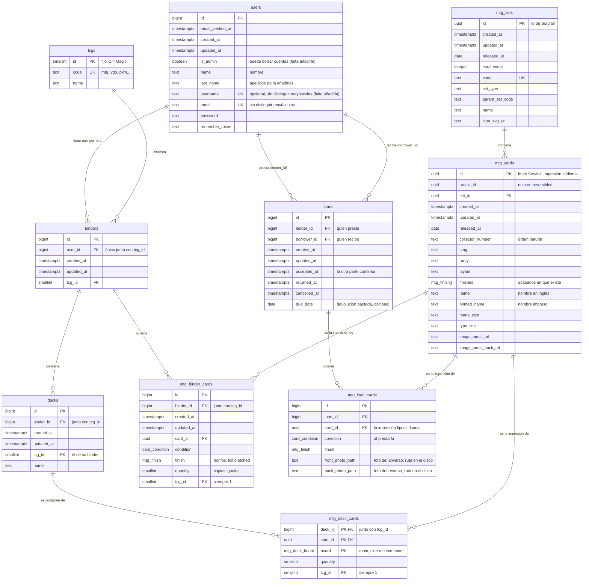

# Modelo de datos

Tablas del catálogo de cartas y de los jugadores. Hay de tres tipos:

- **Ya existen y las crea el ETL** a partir de [`python-scripts/esquema.sql`](../../python-scripts/esquema.sql): `mtg_sets` y `mtg_cards`.
- **Ya existe y la crea Laravel**: `users`, en la migración
  `0001_01_01_000000_create_users_table.php`. Le faltan `last_name`, `username` e
  `is_admin`, y hay que cambiar el tipo de sus fechas y la colación de `email`. Esa
  migración ya se ha ejecutado, así que los cambios van en una migración nueva (ver
  [Decisiones de diseño](#decisiones-de-diseño)).
- **Propuestas, todavía sin migración**: el resto.

Cada TCG tiene su propio catálogo, con los ids de su fuente (en Magic, el uuid de Scryfall).
Las tablas de un TCG llevan su código como prefijo (`mtg_`), y las comunes a todos los
juegos no llevan prefijo.

## Diagrama



## Tablas

| Tabla | Ámbito | Qué guarda |
| --- | --- | --- |
| `users` | Común | Jugadores y administradores. Nombre, apellidos y usuario aparecen en el PDF del préstamo |
| `tcgs` | Común | Juegos de cartas, con un id fijo para cada uno |
| `binders` | Común | La colección de un jugador en un juego. Uno por jugador y TCG |
| `decks` | Común | Mazos de un binder |
| `loans` | Común | Un préstamo entre dos jugadores: quién presta, quién recibe y fechas |
| `mtg_sets` | Magic | Expansiones cargadas desde Scryfall |
| `mtg_cards` | Magic | Impresiones en cada idioma, cargadas desde Scryfall, con los acabados en que existen |
| `mtg_binder_cards` | Magic | Cartas de un binder: qué impresión, con qué acabado, en qué estado y cuántas copias |
| `mtg_deck_cards` | Magic | Qué impresiones forman cada mazo, en qué parte del mazo y cuántas copias |
| `mtg_loan_cards` | Magic | Cada copia prestada, con su acabado, su estado y fotos de las dos caras en el momento del préstamo |

Para añadir un TCG hay que darlo de alta en `tcgs` y crear sus cinco tablas: `<tcg>_sets`,
`<tcg>_cards`, `<tcg>_binder_cards`, `<tcg>_deck_cards` y `<tcg>_loan_cards`.

## Decisiones de diseño

### Las tablas que apuntan a una carta son de cada TCG

Las cartas de cada juego están en su propia tabla y con su propio tipo de id. Por eso las
tablas que apuntan a una carta (binder, mazo y préstamo) también son de cada juego. Cada
referencia es una clave ajena real y del tipo correcto (`uuid` en Magic). Con una referencia
polimórfica (`card_type` + `card_id`), la base de datos no podría comprobar que la carta
existe.

Además, cada juego puede tener columnas propias sin dejar columnas vacías en los demás. Por
ejemplo, el acabado foil o etched (`finish`) y el comandante del mazo (`board`) son de Magic.

Lo que es igual en todos los juegos se queda en una sola tabla: jugadores, binders, mazos y
la cabecera del préstamo.

### La base de datos garantiza que un binder solo tiene cartas de su juego

`mtg_binder_cards` no puede apuntar a un binder de Pokémon. Para que lo compruebe la propia
base de datos, se usa una clave ajena compuesta:

- `binders` tiene una restricción `UNIQUE (id, tcg_id)`.
- `mtg_binder_cards.tcg_id` vale siempre 1 (`DEFAULT 1 CHECK (tcg_id = 1)`).
- La clave ajena `(binder_id, tcg_id)` apunta a `binders (id, tcg_id)`, así que solo encaja con
  binders de Magic.

`decks` y `mtg_deck_cards` usan el mismo mecanismo. Así, un mazo solo puede tener cartas del
juego de su binder. En `mtg_binder_cards` y `mtg_deck_cards`, la columna extra ocupa 2 bytes
que caben en el relleno que ya había al final de la fila, así que no ocupa espacio.

### Una copia de Magic se distingue también por su acabado

En Scryfall, una impresión en un idioma tiene un solo `id` aunque exista en normal, foil y
etched (el campo `finishes`). Una copia foil y una normal de la misma impresión valen
distinto, así que el acabado es parte de la copia:

- En `mtg_binder_cards`, `finish` forma parte de la clave única: las copias se agrupan por
  impresión, acabado y estado.
- En `mtg_loan_cards`, `finish` deja constancia de qué copia exacta se prestó.

El ETL guarda en `mtg_cards.finishes` los acabados en que existe cada impresión, y la
aplicación solo acepta para una copia un acabado de esa lista. Por ejemplo, no deja registrar
como foil una carta que solo se imprimió en normal.

`mtg_deck_cards` no tiene acabado, porque el acabado no cambia cómo se juega la carta.

### Una carta puede estar a la vez en el mazo principal y en el banquillo

`mtg_deck_cards.board` indica en qué parte del mazo va la carta: el mazo principal (`main`),
el banquillo (`side`) o el comandante (`commander`). Forma parte de la clave primaria, así
que un mazo puede llevar dos copias de una carta en el principal y otras dos en el banquillo.
Con la clave `(deck_id, card_id)` eso no era posible.

### Los estados, los acabados y las partes del mazo son tipos enumerados

```sql
CREATE TYPE card_condition AS ENUM ('PO', 'PL', 'LP', 'GD', 'EX', 'NM', 'MT');
CREATE TYPE mtg_finish     AS ENUM ('nonfoil', 'foil', 'etched');
CREATE TYPE mtg_deck_board AS ENUM ('main', 'side', 'commander');
```

`card_condition` usa los códigos de la
[guía de condiciones de Cardmarket](https://help.cardmarket.com/en/CardCondition), de peor a
mejor: Poor, Played, Light Played, Good, Excellent, Near Mint y Mint. Cardmarket usa la misma
escala en todos los juegos, así que el tipo es común. Los tipos con prefijo `mtg_` son de
Magic. `mtg_finish` usa los mismos valores que Scryfall y lo crea el ETL en `esquema.sql`,
porque lo usa `mtg_cards.finishes`; las migraciones de Laravel lo reutilizan.

Un enumerado tiene dos ventajas sobre un texto: rechaza cualquier valor que no esté en la
lista y ocupa siempre 4 bytes. Además, sus valores se ordenan según la lista: como
`card_condition` va de peor a mejor, `condition >= 'EX'` significa "Excellent o mejor".

En PostgreSQL, `$table->enum()` de Laravel crea un `varchar` con un `CHECK`, no un tipo
enumerado. `card_condition` y `mtg_deck_board` se crean en la migración con
`DB::statement()`, dentro del mismo bloque `DO` que usa `esquema.sql` para `mtg_finish`:

```sql
DO $$
BEGIN
    CREATE TYPE card_condition AS ENUM ('PO', 'PL', 'LP', 'GD', 'EX', 'NM', 'MT');
EXCEPTION WHEN duplicate_object THEN NULL;
END
$$;
```

La sentencia tiene que poder repetirse. `migrate:fresh`, y `RefreshDatabase` en los tests,
borran las tablas pero no los tipos (salvo con `--drop-types`) ni las colaciones. Sin el
bloque, la migración fallaría desde la segunda vez con `type "card_condition" already exists`.

### El estado del préstamo sale de sus fechas

`loans` no tiene una columna de estado. El estado se deduce de las fechas:

| Estado | `accepted_at` | `returned_at` | `cancelled_at` |
| --- | --- | --- | --- |
| Pendiente de confirmar | nulo | nulo | nulo |
| Activo | con fecha | nulo | nulo |
| Devuelto | con fecha | con fecha | nulo |
| Cancelado | — | nulo | con fecha |

Así el estado nunca contradice a las fechas. Por ejemplo, no puede haber un préstamo
"devuelto" sin fecha de devolución. Además queda registrado cuándo ocurrió cada paso, y eso
es justo lo que necesita un testigo del pacto.

### Las fechas son `timestamptz`

Las tablas del ETL usan `timestamptz`. En cambio, `$table->timestamps()` de Laravel crea en
PostgreSQL columnas `timestamp without time zone`, como las que tiene hoy `users`. Las tablas
nuevas usan `$table->timestampsTz()` y `$table->timestampTz()`. La migración nueva de `users`
convierte sus fechas con `ALTER COLUMN … TYPE timestamptz USING … AT TIME ZONE 'UTC'`, porque
Laravel las ha escrito en UTC (`config/app.php`).

La conexión `pgsql` de `config/database.php` fija además `'timezone' => 'UTC'`. Laravel envía
las fechas sin zona horaria y PostgreSQL las interpreta en la zona de la sesión. Sin esa
opción, un servidor con otra zona por defecto guardaría las horas desplazadas, y no
coincidirían con las que escribe el ETL con `now()`.

Un `timestamptz` guarda un instante exacto. Un `timestamp` sin zona guarda solo la fecha y la
hora, sin decir de qué zona horaria; si cambia la zona de la aplicación o del servidor, las
fechas antiguas cambian de significado. Un testigo de cuándo se aceptó y se devolvió un
préstamo no puede tener fechas ambiguas. Los dos tipos ocupan 8 bytes.

### El correo y el usuario no distinguen mayúsculas

```sql
CREATE COLLATION IF NOT EXISTS ignora_mayusculas (provider = icu, locale = 'und-u-ks-level2', deterministic = false);
```

`users.email` y `users.username` usan esta colación. Con ella:

- La restricción única rechaza `Ana` si ya existe `ana`. El usuario aparece en el PDF del
  préstamo, y dos usuarios que solo se diferencian en las mayúsculas podrían hacerse pasar
  uno por otro.
- Las consultas de Laravel (`where('email', …)`, el inicio de sesión y la regla de validación
  `unique:users`) comparan sin distinguir mayúsculas, sin `lower()` ni índices de expresión.

Las tildes sí se distinguen: `jose` y `josé` son usuarios distintos.

La migración nueva de `users` crea la colación (con `IF NOT EXISTS`, porque `migrate:fresh`
no borra las colaciones), se la asigna a `email` y crea `username` ya
con ella (`->collation('ignora_mayusculas')`). Antes de cambiar `email` tiene que comprobar
que no hay correos que solo se diferencian en las mayúsculas: si los hay, el índice único no
se puede reconstruir y la migración falla.

### Cada copia prestada tiene foto del anverso y del reverso

La guía de Cardmarket revisa las dos caras de la carta, así que `mtg_loan_cards` tiene dos
fotos obligatorias: `front_photo_path` y `back_photo_path`. Son dos columnas y no una tabla
aparte porque siempre son exactamente dos.

Las columnas guardan la ruta de la foto dentro del disco de Laravel (por ejemplo,
`prestamos/15/3-anverso.jpg`), no su URL. El enlace se genera al mostrarla, con
`Storage::url()`, o con `Storage::temporaryUrl()` si tiene que caducar.

- Si las fotos cambian de disco o de dominio, no hay que tocar ninguna fila.
- Funciona igual con el disco local que con un almacenamiento externo, así que dónde se
  guarden las fotos no cambia el esquema.
- Un enlace que caduca no se puede guardar en la base de datos.

### El idioma de la carta prestada lo fija la impresión

En Magic, `card_id` identifica una impresión en un idioma concreto (`mtg_cards.lang`). Por
eso `mtg_loan_cards` no tiene columna `lang`. El idioma se sigue guardando, pero en un único
sitio, y no puede contradecir a la carta.

Una copia solo se puede registrar en un idioma que esté en Scryfall, y Scryfall no tiene todas
las impresiones en todos los idiomas. Basta con que estén las de los idiomas principales de la
UE (inglés, alemán, francés, italiano, español y portugués), así que las copias no tienen una
columna `lang` propia.

Si el catálogo de otro TCG no separa los idiomas, sus tablas `<tcg>_binder_cards` y
`<tcg>_loan_cards` sí tendrán `lang`.

### Los mazos apuntan al catálogo, no a las copias del binder

`mtg_deck_cards` guarda qué impresión y cuántas copias lleva el mazo. No apunta a una fila de
`mtg_binder_cards`. Las copias del binder se agrupan por acabado y estado, y si una copia pasa
de NM a EX cambia de fila; si el mazo apuntara a esa fila, perdería la carta.

Para saber si el jugador tiene las cartas del mazo, se cruza con `mtg_binder_cards`. Esto
permite además montar mazos con cartas que todavía no se tienen.

### Sin columnas que no se usan

- **Las líneas del préstamo no tienen `created_at` ni `updated_at`**: se crean junto con el
  préstamo y no cambian. En el modelo, `public $timestamps = false`.
- **`mtg_deck_cards` es una tabla pivote sin id propio**: su clave primaria es
  `(deck_id, card_id, board)`.
- **Las cantidades son `smallint`.**
- **Las columnas van ordenadas por alineación**, como en `esquema.sql`: primero las de 8 bytes,
  después `uuid`, después las de 4 y 2 bytes, y el texto al final.

## Restricciones

| Tabla | Restricción | Para qué |
| --- | --- | --- |
| `users` | `UNIQUE (email)` y `UNIQUE (username)`, con la colación `ignora_mayusculas` | Ni el correo ni el usuario se repiten cambiando las mayúsculas |
| `binders` | `UNIQUE (user_id, tcg_id)` | Un binder por jugador y TCG |
| `binders` | `UNIQUE (id, tcg_id)` | Destino de las claves ajenas compuestas |
| `decks` | FK `(binder_id, tcg_id)` → `binders (id, tcg_id)` | El mazo es del juego de su binder |
| `decks` | `UNIQUE (id, tcg_id)` | Destino de la clave ajena de `mtg_deck_cards` |
| `mtg_binder_cards` | FK `(binder_id, tcg_id)` → `binders (id, tcg_id)`, `CHECK (tcg_id = 1)` | Solo en binders de Magic |
| `mtg_binder_cards` | `UNIQUE (binder_id, card_id, finish, condition)` | Las copias iguales van en una sola fila |
| `mtg_binder_cards`, `mtg_deck_cards` | `CHECK (quantity > 0)` | No hay filas con cero copias |
| `mtg_deck_cards` | FK `(deck_id, tcg_id)` → `decks (id, tcg_id)`, `CHECK (tcg_id = 1)` | Solo en mazos de Magic |
| `loans` | `CHECK (lender_id <> borrower_id)` | Nadie se presta a sí mismo |
| `loans` | `CHECK (returned_at IS NULL OR accepted_at IS NOT NULL)` | Solo se devuelve lo que se aceptó |
| `loans` | `CHECK (returned_at IS NULL OR cancelled_at IS NULL)` | No puede estar devuelto y cancelado a la vez |
| `loans` | `CHECK (accepted_at >= created_at)`, `CHECK (returned_at >= accepted_at)`, `CHECK (cancelled_at >= created_at)`, `CHECK (cancelled_at >= accepted_at)` | Las fechas van en orden |
| `mtg_loan_cards` | `front_photo_path NOT NULL`, `back_photo_path NOT NULL` | Cada copia prestada tiene foto de las dos caras |
| `mtg_cards` | `finishes NOT NULL`, `CHECK (cardinality(finishes) > 0)` | Toda impresión existe en al menos un acabado |

Tres reglas quedan para la aplicación, porque afectan a varias tablas:

- **Un préstamo tiene al menos una carta**, sumando todas las tablas `<tcg>_loan_cards`. Un
  préstamo puede mezclar cartas de varios juegos.
- **Cada copia prestada es una fila**: `mtg_loan_cards` no tiene `quantity`, porque cada copia
  tiene su propio estado y sus propias fotos. Prestar tres copias son tres filas.
- **El acabado de una copia existe en su impresión**: `finish = ANY (mtg_cards.finishes)`,
  en `mtg_binder_cards` y `mtg_loan_cards`. Una clave ajena no puede comprobar un valor de un
  array. Se comprueba al registrar o cambiar una copia. Si después Scryfall corrige la carta y
  le quita un acabado, las copias que ya lo tienen se conservan: la copia física sigue
  existiendo aunque el catálogo cambie.

## Borrados

| Clave ajena | Al borrar la fila a la que apunta | Por qué |
| --- | --- | --- |
| `binders.user_id`, `decks` → `binders`, `mtg_binder_cards` → `binders`, `mtg_deck_cards` → `decks`, `mtg_loan_cards.loan_id` | Se borra en cascada (`cascadeOnDelete()`) | Son parte de la fila a la que apuntan |
| `loans.lender_id`, `loans.borrower_id` | Se borra en cascada (`cascadeOnDelete()`) | Solo un administrador borra cuentas, y puede borrarlo todo |
| `card_id` de las tablas `mtg_*_cards`, `binders.tcg_id` | Se impide (lo que hace PostgreSQL por defecto) | Protege los datos de los jugadores |

Solo un administrador (`users.is_admin`) puede borrar cuentas y préstamos, y puede borrar
cualquier cosa. Lo comprueba la aplicación, con policies de Laravel, no la base de datos.
Borrar una cuenta borra todo lo suyo: su binder, sus mazos, sus cartas y los préstamos en los
que participa, aunque también sean de la otra persona.

Los jugadores no borran préstamos: los cancelan (`cancelled_at`), y el préstamo queda
registrado.

## Índices

| Índice | Para qué |
| --- | --- |
| `binders (user_id, tcg_id)`, único | Los binders de un jugador. Cubre la clave ajena `user_id` |
| `decks (binder_id)` | Los mazos de un binder |
| `mtg_binder_cards (binder_id, card_id, finish, condition)`, único | El contenido de un binder. Cubre la clave ajena hacia `binders` |
| `mtg_binder_cards (card_id)` | Quién tiene una carta, para pedírsela prestada |
| `mtg_deck_cards (deck_id, card_id, board)`, clave primaria | El contenido de un mazo. Cubre la clave ajena hacia `decks` |
| `mtg_loan_cards (loan_id)` | Las cartas de un préstamo |
| `loans (lender_id)` y `loans (borrower_id)` | Los préstamos de un jugador, como prestamista o como prestatario |

Cada clave ajena que se borra en cascada tiene un índice que empieza por sus columnas. Así, borrar una cuenta, un binder o un préstamo no
recorre tablas enteras.

`mtg_deck_cards.card_id` y `mtg_loan_cards.card_id` no tienen índice propio. Solo servirían
para borrar cartas del catálogo, y el ETL nunca borra: solo inserta o actualiza por `id`.

## Efecto en la ingesta

El ETL no se ve afectado por las claves ajenas, porque nunca borra cartas.

El ETL crea el tipo `mtg_finish` y las tablas del catálogo, y las tablas de los jugadores
apuntan a ellos. En una base de datos vacía, la migración de Laravel que cree las tablas
`mtg_*` fallaría si el ETL no se ha ejecutado antes. Eso pasa en la primera puesta en marcha
de [ejecucion-proyecto.md](../procesos/ejecucion-proyecto.md), donde `composer setup` migra
antes de la carga inicial, y en los tests de Laravel. Por eso esa migración tiene que aplicar
antes `python-scripts/esquema.sql`, que es idempotente, y así no depende del orden.

La migración tiene que aplicar el fichero dentro de su transacción, que es lo que hace Laravel
por defecto en PostgreSQL. El fichero empieza tomando un bloqueo que dura hasta el final de la
transacción, y así el ETL y la migración no lo aplican a la vez.

Cuando existan esas tablas, ya no se podrá aplicar un cambio de `esquema.sql` borrando
`mtg_cards` y `mtg_sets`: las claves ajenas lo impiden. Habrá que hacerlo con `ALTER TABLE`,
como explica la [documentación de la ingesta](../procesos/ingesta.md#tablas), y nunca con
`DROP TABLE … CASCADE`, que borraría en silencio las claves ajenas de las tablas de los
jugadores.

También cambia el arreglo manual del **código de set ocupado** que describe la
[documentación de la ingesta](../procesos/ingesta.md), que consiste en borrar el set que sobra
y sus cartas. Si algún jugador tiene cartas de ese set en un binder, un mazo o un préstamo,
las claves ajenas impiden el borrado. Antes hay que cambiar esas referencias a las
impresiones del set nuevo.

## Pendiente de decidir

- **Dónde se guardan las fotos**: en el disco local de Laravel (`storage/`) o en un
  almacenamiento externo. No cambia el esquema, porque las columnas de las fotos guardan la
  ruta dentro del disco.
