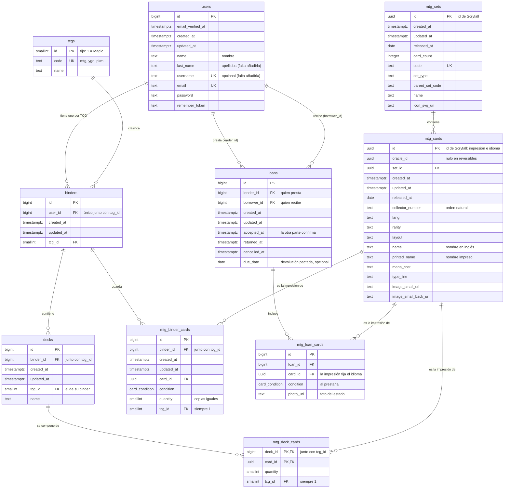

# Modelo de datos

Tablas del catálogo de cartas y de los jugadores. Hay de tres tipos:

- **Ya existen y las crea el ETL** a partir de [`python-scripts/esquema.sql`](../../python-scripts/esquema.sql): `mtg_sets` y `mtg_cards`.
- **Ya existe y la crea Laravel**: `users`, en la migración
  `0001_01_01_000000_create_users_table.php`. Le faltan `last_name` y `username`.
- **Propuestas, todavía sin migración**: el resto.

Cada TCG tiene su propio catálogo, con los ids de su fuente (en Magic, el uuid de Scryfall).
Las tablas de un TCG llevan su código como prefijo (`mtg_`), y las comunes a todos los
juegos no llevan prefijo.

## Diagrama



## Tablas

| Tabla | Ámbito | Qué guarda |
| --- | --- | --- |
| `users` | Común | Jugadores. Nombre, apellidos y usuario aparecen en el PDF del préstamo |
| `tcgs` | Común | Juegos de cartas, con un id fijo para cada uno |
| `binders` | Común | La colección de un jugador en un juego. Uno por jugador y TCG |
| `decks` | Común | Mazos de un binder |
| `loans` | Común | Un préstamo entre dos jugadores: quién presta, quién recibe y fechas |
| `mtg_sets` | Magic | Expansiones cargadas desde Scryfall |
| `mtg_cards` | Magic | Impresiones en cada idioma, cargadas desde Scryfall |
| `mtg_binder_cards` | Magic | Cartas de un binder: qué impresión, cuántas copias y en qué estado |
| `mtg_deck_cards` | Magic | Qué impresiones forman cada mazo y cuántas copias |
| `mtg_loan_cards` | Magic | Cada copia prestada, con su estado y su foto en el momento del préstamo |

Para añadir un TCG hay que darlo de alta en `tcgs` y crear sus cinco tablas: `<tcg>_sets`,
`<tcg>_cards`, `<tcg>_binder_cards`, `<tcg>_deck_cards` y `<tcg>_loan_cards`.

## Decisiones de diseño

### Las tablas que apuntan a una carta son de cada TCG

Las cartas de cada juego están en su propia tabla y con su propio tipo de id. Por eso las
tablas que apuntan a una carta (binder, mazo y préstamo) también son de cada juego. Cada
referencia es una clave ajena real y del tipo correcto (`uuid` en Magic). Con una referencia
polimórfica (`card_type` + `card_id`), la base de datos no podría comprobar que la carta
existe.

Además, cada juego puede tener columnas propias sin dejar columnas vacías en los demás. Por
ejemplo, el acabado de una carta de Magic (normal, foil o etched) no existe en otros juegos.

Lo que es igual en todos los juegos se queda en una sola tabla: jugadores, binders, mazos y
la cabecera del préstamo.

### La base de datos garantiza que un binder solo tiene cartas de su juego

`mtg_binder_cards` no puede apuntar a un binder de Pokémon. Para que lo compruebe la propia
base de datos, se usa una clave ajena compuesta:

- `binders` tiene una restricción `UNIQUE (id, tcg_id)`.
- `mtg_binder_cards.tcg_id` vale siempre 1 (`DEFAULT 1 CHECK (tcg_id = 1)`).
- La clave ajena `(binder_id, tcg_id)` apunta a `binders (id, tcg_id)`, así que solo encaja con
  binders de Magic.

`decks` y `mtg_deck_cards` usan el mismo mecanismo. Así, un mazo solo puede tener cartas del
juego de su binder. En `mtg_binder_cards` y `mtg_deck_cards`, la columna extra ocupa 2 bytes
que caben en el relleno que ya había al final de la fila, así que no ocupa espacio.

### El estado de la carta es un tipo enumerado

```sql
CREATE TYPE card_condition AS ENUM ('PO', 'PL', 'LP', 'GD', 'EX', 'NM', 'MT');
```

Son los códigos de la
[guía de condiciones de Cardmarket](https://help.cardmarket.com/en/CardCondition), de peor a
mejor: Poor, Played, Light Played, Good, Excellent, Near Mint y Mint. Cardmarket usa la misma
escala en todos los juegos, así que el tipo es común.

Un enumerado tiene tres ventajas sobre un texto:

- Rechaza cualquier valor que no esté en la lista.
- Ocupa siempre 4 bytes.
- Se ordena por gravedad, así que `condition >= 'EX'` significa "Excellent o mejor".

En PostgreSQL, `$table->enum()` de Laravel crea un `varchar` con un `CHECK`, no un tipo
enumerado. El tipo se crea con `DB::statement()` en la migración.

### El estado del préstamo sale de sus fechas

`loans` no tiene una columna de estado. El estado se deduce de las fechas:

| Estado | `accepted_at` | `returned_at` | `cancelled_at` |
| --- | --- | --- | --- |
| Pendiente de confirmar | nulo | nulo | nulo |
| Activo | con fecha | nulo | nulo |
| Devuelto | con fecha | con fecha | nulo |
| Cancelado | — | nulo | con fecha |

Así el estado nunca contradice a las fechas. Por ejemplo, no puede haber un préstamo
"devuelto" sin fecha de devolución. Además queda registrado cuándo ocurrió cada paso, y eso
es justo lo que necesita un testigo del pacto.

### El idioma de la carta prestada lo fija la impresión

En Magic, `card_id` identifica una impresión en un idioma concreto (`mtg_cards.lang`). Por
eso `mtg_loan_cards` no tiene columna `lang`. El idioma se sigue guardando, pero en un único
sitio, y no puede contradecir a la carta.

Si el catálogo de otro TCG no separa los idiomas, sus tablas `<tcg>_binder_cards` y
`<tcg>_loan_cards` sí tendrán `lang`.

### Los mazos apuntan al catálogo, no a las copias del binder

`mtg_deck_cards` guarda qué impresión y cuántas copias lleva el mazo. No apunta a una fila de
`mtg_binder_cards`. Las copias del binder se agrupan por estado, y si una copia pasa de NM a
EX cambia de fila; si el mazo apuntara a esa fila, perdería la carta.

Para saber si el jugador tiene las cartas del mazo, se cruza con `mtg_binder_cards`. Esto
permite además montar mazos con cartas que todavía no se tienen.

### Sin columnas que no se usan

- **Las líneas del préstamo no tienen `created_at` ni `updated_at`**: se crean junto con el
  préstamo y no cambian. En el modelo, `public $timestamps = false`.
- **`mtg_deck_cards` es una tabla pivote sin id propio**: su clave primaria es
  `(deck_id, card_id)`.
- **Las cantidades son `smallint`.**
- **Las columnas van ordenadas por alineación**, como en `esquema.sql`: primero las de 8 bytes,
  después `uuid`, después las de 4 y 2 bytes, y el texto al final.

## Restricciones

| Tabla | Restricción | Para qué |
| --- | --- | --- |
| `binders` | `UNIQUE (user_id, tcg_id)` | Un binder por jugador y TCG |
| `binders` | `UNIQUE (id, tcg_id)` | Destino de las claves ajenas compuestas |
| `decks` | FK `(binder_id, tcg_id)` → `binders (id, tcg_id)` | El mazo es del juego de su binder |
| `decks` | `UNIQUE (id, tcg_id)` | Destino de la clave ajena de `mtg_deck_cards` |
| `mtg_binder_cards` | FK `(binder_id, tcg_id)` → `binders (id, tcg_id)`, `CHECK (tcg_id = 1)` | Solo en binders de Magic |
| `mtg_binder_cards` | `UNIQUE (binder_id, card_id, condition)` | Las copias iguales van en una sola fila |
| `mtg_binder_cards`, `mtg_deck_cards` | `CHECK (quantity > 0)` | No hay filas con cero copias |
| `mtg_deck_cards` | FK `(deck_id, tcg_id)` → `decks (id, tcg_id)`, `CHECK (tcg_id = 1)` | Solo en mazos de Magic |
| `loans` | `CHECK (lender_id <> borrower_id)` | Nadie se presta a sí mismo |
| `loans` | `CHECK (returned_at IS NULL OR accepted_at IS NOT NULL)` | Solo se devuelve lo que se aceptó |
| `loans` | `CHECK (returned_at IS NULL OR cancelled_at IS NULL)` | No puede estar devuelto y cancelado a la vez |
| `mtg_loan_cards` | `photo_url NOT NULL` | Cada copia prestada tiene su foto |

Dos reglas quedan para la aplicación, porque afectan a varias tablas:

- **Un préstamo tiene al menos una carta**, sumando todas las tablas `<tcg>_loan_cards`. Un
  préstamo puede mezclar cartas de varios juegos.
- **Cada copia prestada es una fila**: `mtg_loan_cards` no tiene `quantity`, porque cada copia
  tiene su propio estado y su propia foto. Prestar tres copias son tres filas.

## Índices

| Índice | Para qué |
| --- | --- |
| `binders (user_id, tcg_id)`, único | Los binders de un jugador. Cubre la clave ajena `user_id` |
| `decks (binder_id)` | Los mazos de un binder |
| `mtg_binder_cards (binder_id, card_id, condition)`, único | El contenido de un binder. Cubre la clave ajena hacia `binders` |
| `mtg_binder_cards (card_id)` | Quién tiene una carta, para pedírsela prestada |
| `mtg_deck_cards (deck_id, card_id)`, clave primaria | El contenido de un mazo |
| `mtg_loan_cards (loan_id)` | Las cartas de un préstamo |
| `loans (lender_id)` y `loans (borrower_id)` | Los préstamos de un jugador, como prestamista o como prestatario |

`mtg_deck_cards.card_id` y `mtg_loan_cards.card_id` no tienen índice propio. Solo servirían
para borrar cartas del catálogo, y el ETL nunca borra: solo inserta o actualiza por `id`.

## Efecto en la ingesta

El ETL no se ve afectado por las claves ajenas, porque nunca borra cartas.

Sí cambia el arreglo manual del **código de set ocupado** que describe la
[documentación de la ingesta](../procesos/ingesta.md), que consiste en borrar el set que sobra
y sus cartas. Si algún jugador tiene cartas de ese set en un binder, un mazo o un préstamo,
las claves ajenas impiden el borrado. Antes hay que cambiar esas referencias a las
impresiones del set nuevo.

## Pendiente de decidir

- **Dónde se guardan las fotos**: `photo_url` es solo el enlace. Falta decidir si las fotos
  van al disco de Laravel (`storage/`) o a un almacenamiento externo.
